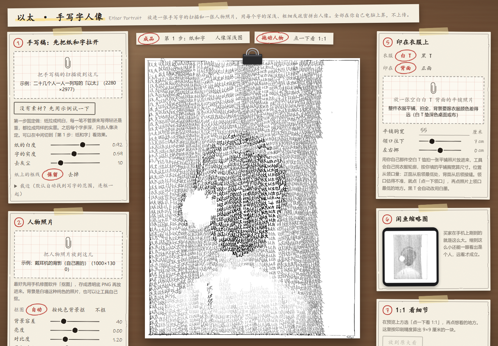
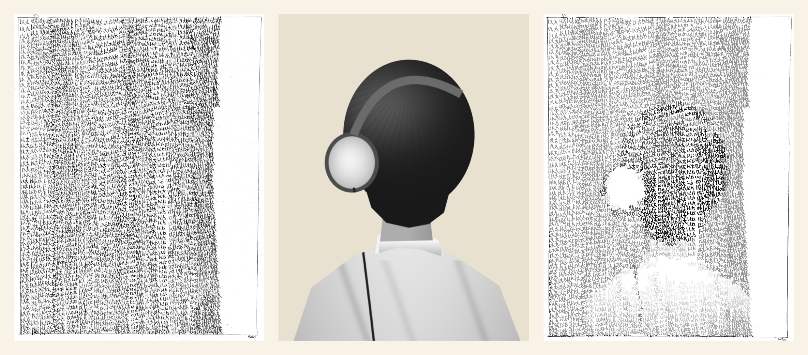
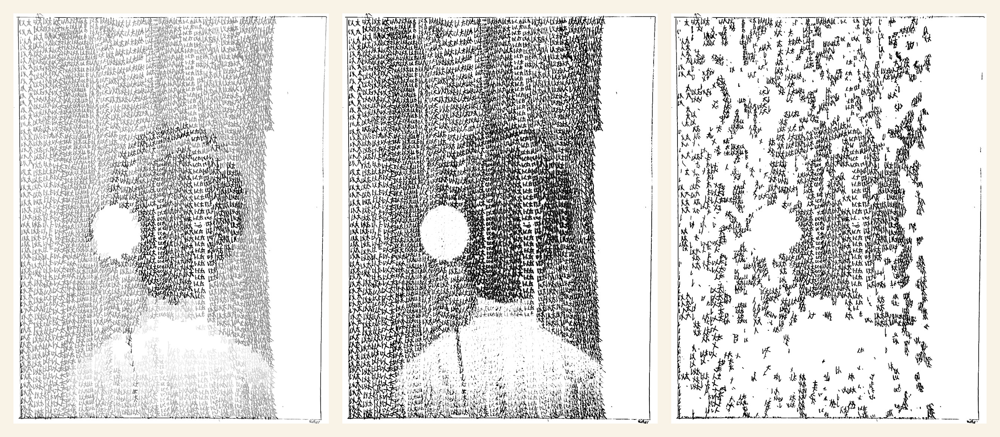
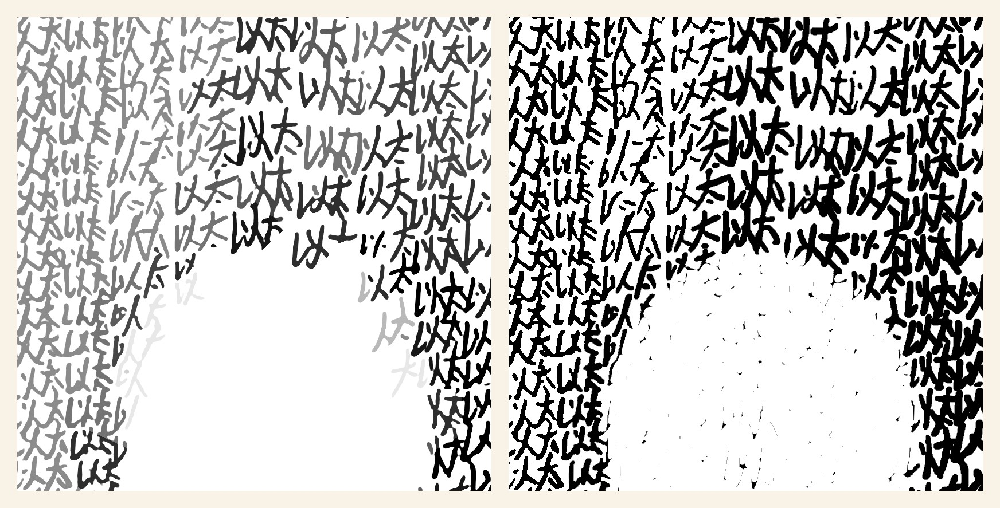
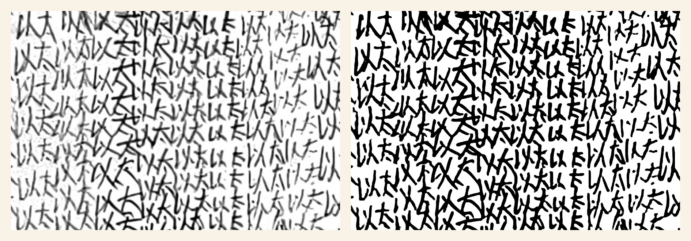

<div align="center">

# 以太 · 手写字人像

Ether Portrait

把一页手写字变成一张人像。每个字都还是原来那个字，只是深浅不一样，退远一看，是一个人。

[打开就能用](https://lxy3312.github.io/ether-portrait/) · [直接看示例](https://lxy3312.github.io/ether-portrait/?demo) · [English](#english)

</div>



## 它是怎么来的

这个工具是做一件 T 恤背面的时候做出来的。

二十几个同学，每人在一张纸上写了一列「以太」。人没找齐，纸的右边空了一截没写满。我想把一个戴着耳机的背影藏进这些字里，让人远看是一个人，凑近看全是字。

试了好几种办法都不行。在字上再叠一层字，头发那块就挤成一团乱线，一个字都认不出来。把字删掉留出人形，人就成了一团云。把笔画加粗，放大一看全是糊掉的墨团。

最后想明白了：一个字都不要改，只换「每个字是用什么笔写的」。头发那里的字用最黑的笔，耳机那里的字用很淡的铅笔，衬衫那里的字几乎看不见。每个字都还是同学写的那个完整的字，人是靠字的深浅浮出来的。

这个网页就是把这件事做成了谁都能用的样子：你有一页手写字、一张人物照片，几秒钟就能出图，还能直接导出拿去印。



## 它能做什么

- 放一张手写字的扫描、一张人物照片，几秒钟出图。人物可以直接在预览上拖动。
- 第一步固定先把纸和字拉开：纸一律变成纯白，每一笔不管原来写得轻还是重，都拉成同样的实墨。之后每个字多深，只由人像决定，原稿上谁下笔重、扫描仪哪边暗，都不会再干扰人像。
- 三种画法，见下面的对比图。
- 人和周围的字之间是渐变过去的，看不出一条剪出来的边；人的下半身可以慢慢化进字里；整块字的四边也可以散掉，不是一个方块。
- 能自动认出纸上用尺子画的框，可以留着，也可以去掉。
- 放一张你自己那件空白 T 恤的平铺照片，就能看到印上去的样子，白 T 黑 T 都行，黑 T 会自动改用白墨。
- 一键看缩到手机缩略图那么大是什么样。缩到这么小还认得出是个人，远看才成立。
- 在预览上点任意一个地方，按印刷精度算出那一块 9×9 厘米，检查笔画有没有糊、有没有断。
- 导出 300 dpi 的白底或透明底 PNG，文件里写好了 dpi，可以直接发给印 T 恤的店。
- 全部在你自己的浏览器里算，图片不会上传到任何地方。整个工具就是一个 html 文件，不用装任何东西。
- 调好的参数可以存成一个小文件，下次载入接着用。



从左到右：

- 深浅：每个字整个换一种墨色。头发那里的字最黑，衬衫、耳机那里的字最淡。层次最细，但有灰色，要用数码直喷印。
- 粗细：全部用纯黑，靠笔画的粗细出人像：暗的地方笔画加粗，亮的地方变细直到消失。没有灰色，丝网印也能印。
- 疏密：全部用纯黑，靠字的多少出人像：暗的地方字都留着，亮的地方只留几个，每个字要么整个留下，要么整个删掉。字写得比较稀的稿子用它效果好，像示例这种写得很密的，用前两种更清楚。

## 每个字都还是原来的字

下面是印出来 7×7 厘米的一块，按 1:1 放大。左边是「深浅」，右边是「粗细」。中间那块白是耳机。字没有被切开，没有被叠在一起，没有一个字被改过。



第一步「把纸和字拉开」前后对比。左边是扫描原样：纸发灰、有灰尘点、有的同学写得轻有的写得重；右边是拉开以后：纸是纯白，每一笔都是同样的实墨。



## 怎么用

1. 打开网页。手头还没有素材，先点「没有素材？先用示例试一下」。
2. 放手写稿。用手机或扫描仪扫一页写满字的纸，拖进第 1 张稿纸。工具会自己找到写字的范围和纸上的框。
3. 放人物照片。最好先用手机修图软件「抠图」，存成透明底的 PNG 再放进来；背景是白墙这种纯色的照片，工具也可以自己抠。
4. 摆放。直接在中间拖动人物，用滑块调大小、边缘渐变多宽、下面化掉多少、周围的字多深。头发要比周围的字深，脸和衣领要比周围的字浅，人才浮得出来。
5. 选画法。深浅、粗细、疏密三选一。
6. 看效果。右边放一张你那件空白 T 恤的平铺照片，看印上去的样子；看手机缩略图那一格；在预览上点「点一下看 1:1」检查细节。
7. 导出。填好印刷宽度（厘米），导出白底或透明底 PNG，发给印衣服的店。

## 怎么做出来更好看

这些是我们做那件 T 恤时踩坑踩出来的。

- 字要够大。每个字印出来最好有 7 毫米以上，再小远看就糊成一团灰。工具导出前会算一下，不够会提醒你。字写得小的话，可以把印刷尺寸调大，或者在「裁边」里只取原稿的一部分。
- 原稿用 600 dpi 扫。手机拍的也能用，但印 30 厘米宽的话，扫描精度不够，笔画边会发软。工具也会提醒。
- 人物照片要反差大、背景干净、轮廓简单。背影、侧影、戴着帽子或耳机这种一眼能认出来的轮廓最好。脸部细节这种方法表现不出来，别指望。
- 人放大一点。人越大，每个部位分到的字越多，越认得出来。
- 印法：「深浅」有灰色，白 T 用数码直喷最合适；「粗细」「疏密」是纯黑，直喷、丝网印都行。黑 T 用白墨。
- 很多直喷店最大只能印 A3（大约 30×42 厘米），下单前先问清楚。
- 先打一件样，穿上，洗一次，再决定要不要多做。屏幕上看着好不算数。

## 它是怎么做的

不懂技术的可以跳过这一节。

- 纸和字拉开：先用一个比字还大的窗口取最大值，把字「抹掉」，得到纸本身的颜色，再除掉它。这样扫描时的阴影、纸发黄都去掉了。然后每一笔按它自己最深的那一点拉成实墨，写得轻的字和写得重的字变得一样黑。
- 认框线：框线又细又直又长。沿着几十个稍微倾斜的方向，把整条线上的墨量求平均，真的框线会在某个方向上特别集中，写得再密的字也不会这样。每一边只认一条。
- 切字：先按连在一起的笔画分块；写得太密、好几个字连成一大片的，按一个字大概多大，用聚类把它拆开。
- 人像深浅图：照片先拉一点局部对比，让头发里的反光、衣领的折线出得来；人的边缘做成两三个字宽的渐变，再加一点不规则，像墨洇开。
- 三种画法：「深浅」是每个字取它中心位置的深浅，整个字换一种灰；「粗细」用距离变换算出每个点离笔画边缘多远，按毫米让笔画变粗或变细；「疏密」用 8×8 的有序抖动表决定哪个字留、哪个字删，不会删出一块一块的洞。
- 导出：按印刷精度一块一块地算，每块四周多算一圈再切掉，接缝处看不出来。导出的 PNG 里写进 dpi，印花店打开就是 300 dpi。

整个工具没有用任何外部库，就是一个 html 文件里的 JavaScript。

## 自己部署

- 最简单的办法：下载 [index.html](index.html)，双击用浏览器打开就能用。双击打开时，浏览器不让网页读旁边的文件，所以「示例」按钮用不了，把 examples 文件夹里的两张图拖进去就行。
- 放到网上：这个仓库已经开了 GitHub Pages，地址是 https://lxy3312.github.io/ether-portrait/ 。
- 放到你自己的服务器、绑自己的域名：看 [DEPLOY.md](DEPLOY.md)，一步一步写好了。

## 文件

```
index.html                     整个工具
examples/handwriting-ether.jpg 示例手写稿：二十几个同学一人一列写的「以太」
examples/figure-headphones.png 示例人物：一个戴耳机的背影，自己画的
docs/                          这个说明里用到的图
DEPLOY.md                      部署到自己服务器、绑域名的说明
```

## 许可

代码用 MIT 许可，随便用、随便改、随便拿去做衣服卖，保留版权声明就行。

示例图片：`figure-headphones.png` 是我们自己画的，和代码一样用 MIT。`handwriting-ether.jpg` 是二十几位同学手写的，经他们同意放在这里做示例；想用在别的地方，请先开一个 issue 问一下。

## 致谢

谢谢每一个写了一列「以太」的同学。

---

<a id="english"></a>

## English

Ether Portrait turns a page of handwriting into a portrait. Every character stays exactly as it was written; only its darkness changes. Step back and you see a person.

[Use it online](https://lxy3312.github.io/ether-portrait/) · [Open with the demo loaded](https://lxy3312.github.io/ether-portrait/?demo)

### Where it came from

It started as the back print of a T-shirt. About twenty classmates each wrote one column of the word 以太 ("ether") on one sheet of paper. Not everyone showed up, so the right edge of the sheet was left unfinished. The goal was to hide the back of a boy wearing headphones inside that handwriting.

Layering extra writing turned the hair into a tangle. Deleting characters turned the figure into a blur. Thickening the strokes turned everything into ink blots. What finally worked was to leave every character untouched and only change which "pen" it seems to have been written with: the darkest pen for the hair, a faint pencil for the headphones, almost nothing for the shirt collar. The figure comes out of the darkness of the words.

### What it does

- Drop in a scan of handwriting and a photo of a person; get a result in seconds. Drag the figure around on the preview.
- Step one always separates paper from ink: the paper becomes pure white and every stroke becomes the same solid ink, so uneven pen pressure or scanner shading never fights with the portrait.
- Three rendering modes: tone (each character gets a different shade of grey), weight (pure black, strokes get thicker or thinner), density (pure black, characters are kept or dropped as whole characters with ordered dithering).
- Soft edges between the figure and the surrounding words; the lower body can dissolve into the writing; the whole block can fade out at its edges instead of being a hard rectangle.
- Detects ruled frame lines on the paper; keep them or remove them.
- Drop in a flat-lay photo of your own blank T-shirt to see the print on it. White and black shirts are both supported; black shirts automatically switch to white ink.
- A phone-thumbnail preview, and a 1:1 view of any 9×9 cm area at print resolution.
- Exports 300 dpi PNG with a white or transparent background, with the dpi written into the file, ready for a print shop.
- Everything runs in your browser. Nothing is uploaded. The whole tool is a single HTML file with no dependencies.

The interface is in Chinese for now. The steps are numbered 1 to 8 on the paper cards from left to right: handwriting, photo, placement, mode, shirt preview, thumbnail, 1:1 detail, export.

### Tips

- Make each character at least 7 mm tall in print, or it turns into grey mush from a distance.
- Scan the handwriting at 600 dpi.
- Use a high-contrast photo with a clean background and a simple outline. Silhouettes, backs of heads and profiles work best. Fine facial detail will not survive.
- The tone mode has greys, so print it with direct-to-garment (DTG). The weight and density modes are pure black and also work for screen printing.
- Print one sample, wear it, wash it, then decide.

### License

Code: MIT. `examples/figure-headphones.png` was drawn by us and is also MIT. `examples/handwriting-ether.jpg` was written by about twenty classmates and is included here as a demo with their permission; please open an issue before using it elsewhere.
